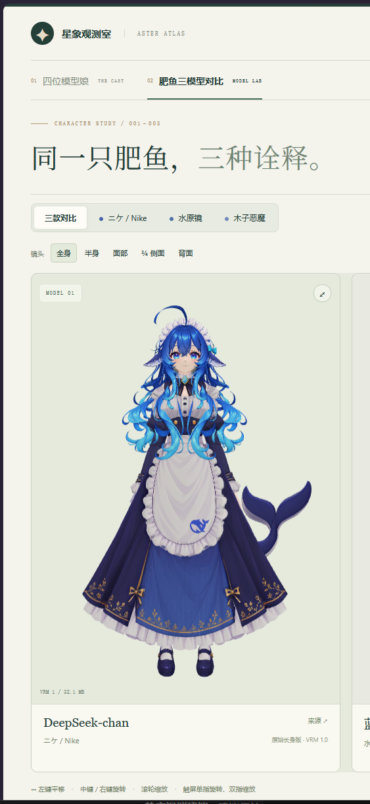

# 星象观测室 · 两个展区，一个页面

本地测试入口：`http://127.0.0.1:62666/`。

线上地址：https://somevincentzyumaths.github.io/test-3d-ds-feiyu/ [](https://somevincentzyumaths.github.io/test-3d-ds-feiyu/)

仓库：https://github.com/SomeVincentZyuMaths/test-3d-ds-feiyu [](https://github.com/SomeVincentZyuMaths/test-3d-ds-feiyu)

[](https://github.com/SomeVincentZyuMaths/test-3d-ds-feiyu/actions/workflows/pages.yml)
[](https://nodejs.org/)
[](https://threejs.org/)
[](https://github.com/pixiv/three-vrm)
[](https://vite.dev/)

[](https://vrm.dev/en/)
[](https://www.khronos.org/webgl/)
[](./public/licenses/DERIVATIVES.md)

- `#cast`：Nike 原版肥鱼，以及共用长身底模的 GPT 白龙、Gemini 猫咪、Claude 太阳花结构改版。支持四人同台和单人观察。
- `#fish`：原有 62667 demo 的三款 VRM，支持并排、单人和联动相机。62667 的原文件未改动，新页面不依赖该端口。

Three.js 与 three-vrm 负责真正的 3D 网格、骨骼和表情。全站仅一个 WebGL 画布和一条渲染循环；切换展区保留各自选择与相机，非当前展区不更新动画。只有需要的模型才下载，重复使用 Nike 时只共享原始字节、不共享可变骨骼实例。

## 页面预览

<p align="center">
  <a href="./preview/deepseek-model-comparison.png">
    
  </a>
</p>

肥鱼三模型对比页 · Nike 长身版。截图由用户提供，点击可查看原图；模型署名与许可见 [来源说明](./SOURCES.md)。

## 本机运行

使用 Node.js 22.12+，执行 `npm ci` 和 `npm run dev`，然后打开 `http://127.0.0.1:62666/`。默认只监听本机。需要启用 WebGL 2。

- 鼠标：左键拖动平移，中键或右键拖动旋转，滚轮缩放；可随时重置视角。
- 触屏：单指旋转，双指缩放、平移。拖动中央手柄调整对照比例；手柄聚焦时也支持方向键、Home 和 End。
- 左侧保留原色作为基准；右侧可切换原色、素模、线框。关闭材质对照后，当前着色占满视窗。
- 「四人同台」按参考顺序排列；身体按头骨基准统一比例，龙角、猫耳不影响身高标尺。
- 镜头支持全身、半身、面部、侧面、背面；表情、待机、T 姿势与角色动作可切换。
- 手机上默认单人，三鱼并排页可在卡片说明区域横向滑动。一级与模型页签支持方向键、Home、End。
- 完整四人首次加载约 120 MiB，适合当前本地模型研究；尚未针对公网下载和低端手机优化。

## 模型源文件

- `public/avatars/`：Nike 原始 VRM 和三个独立改版 VRM。
- `models/nike-source/`：作者原始 `.blend`，不覆盖。
- `models/nike-derived/`：三个可编辑 `.blend` 与导出审计 JSON。
- `local-assets/fish/`：另两款有限制的本地比较资产；已 gitignore，不在 `public/` 内。
- `tools/build_nike_variants.py`：结构改版脚本，保留脸与表情，重做衣装、长发、耳角、翼尾和书等配件。
- `public/cast/`、`models/` 根目录、`src/cast.js` 和旧制作脚本保留，但新页面不使用。
- `npm test`：同时检查旧资产与新 VRM 的结构、骨骼、表情、各角色特征及许可隔离。

### 重建三位改版

制作环境为 Blender 5.2.3 LTS + VRM Add-on for Blender 4.10.2（与源工程一致）。
默认插件目录 `D:/cache/blender/vrm-addon-4.10.2`，可通过 `VRM_ADDON_DIR` 指向包含插件文件夹的目录。

```powershell
& 'D:\SteamLibrary\steamapps\common\Blender\blender.exe' --background --factory-startup --threads 4 --python-exit-code 1 --python tools/build_nike_variants.py
```

末尾加 `-- gpt` 可只重建一位。脚本只覆盖本项目的衍生输出，不改原始源文件。
下载辅助脚本 `node tools/fetch_avatar_source.mjs` 校验 SHA-256，已存在且吻合的文件会跳过。
新增配件属于程序化建模原型，尚不是手工精修角色资产；尤其发束、衣料褶皱和手持姿势仍有提升空间。

## 静态构建

`npm run build` 生成 `dist/`。停止开发服务后可用 `npm run preview` 在同一端口预览。Vite 使用相对资源路径，可部署在 GitHub Pages 的仓库子路径。

`.github/workflows/pages.yml` 在推送 `main` 或手动触发时执行 `npm ci`、资产测试、构建、公开文件审计，然后部署 GitHub Pages。无需额外部署密钥；Actions 引用固定提交，部署权限仅授予部署作业。

生产构建**不会包含** `mirror.vrm` / `muzi.vrm`，对应卡片明确提示「仅本地提供」，也不会请求第三方模型地址。不要直接将整个项目目录公开。

线上页面为非商业同人技术演示。第一次加载四人约 120 MiB，公网下载可能需要等待；手机默认只加载肥鱼。

来源、署名、模型许可和未来部署限制见 [SOURCES.md](./SOURCES.md) 与 [改版记录](./public/licenses/DERIVATIVES.md)。代码组件的许可不替代素材许可。
